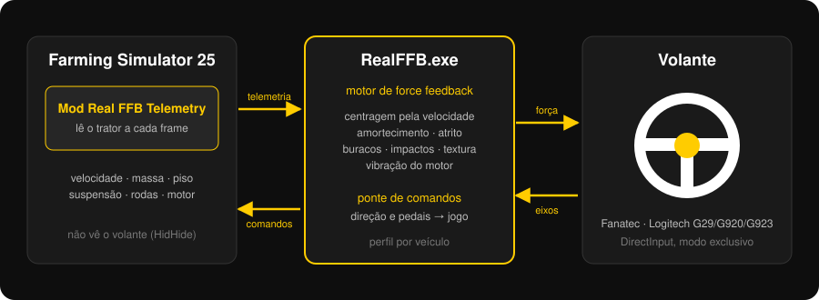

<p align="center">
  
</p>

<p align="center">
  <a href="../../releases/latest"></a>
  <a href="../../releases"></a>
  
  <a href="LICENSE"></a>
</p>

<p align="center">
  <a href="../../releases/latest"><b>⬇ Baixar o instalador</b></a> ·
  <a href="docs/INSTALACAO.md">Guia de instalação</a> ·
  <a href="docs/PROBLEMAS.md">Resolução de problemas</a>
</p>

---

## O problema

O Farming Simulator 25 aceita volantes, mas o force feedback dele é quase inexistente. Em bases direct drive como a Fanatec CSL DD, o volante fica solto: não pesa, não volta ao centro e não sente o terreno. Mexer nas definições do jogo não resolve, porque o jogo simplesmente não gera essas forças.

## A solução

O **FS25 RealFFB** gera o force feedback por fora do jogo. Um mod lê o que acontece com o trator a cada frame. Um programa no Windows transforma isso em forças reais no volante, como nos simuladores de corrida e no Euro Truck Simulator.

<p align="center">
  
  <br><sub>A app a funcionar: definições à esquerda, comandos e forças ao vivo à direita.</sub>
</p>

## O que você sente no volante

| | |
|---|---|
| 🛞 **Centragem realista** | O volante volta ao centro só com o trator em movimento, com mais força quanto maior a velocidade e o peso. Parado, fica onde você o deixar, como num trator de verdade. |
| 🌾 **Terreno** | Asfalto, terra, relva e lavoura têm texturas diferentes. Na estrada sente-se o "zumbido" dos pneus agrícolas. |
| 🕳️ **Buracos e impactos** | Pancadas da suspensão, buracos e batidas chegam ao volante com a força certa. |
| 🚜 **Motor** | Vibração que acompanha as rotações e a carga do motor. |
| 🎚️ **Perfil por veículo** | Cada trator ou máquina guarda as suas afinações. O programa muda sozinho quando você troca de veículo. |
| 🎮 **Outros comandos intactos** | Button box, manetes e alavanca de mudanças continuam a funcionar direto no jogo. |
| 📌 **Fixar no topo** | Janela compacta, sempre visível, para ver os comandos e as forças enquanto joga. |
| 🔄 **Atualizações** | O programa avisa quando há versão nova e só instala com a sua autorização, depois de verificar o arquivo. |

## Volantes suportados

| Fabricante | Modelos | Estado |
|---|---|---|
| **Fanatec** (modo PC) | CSL DD, GT DD Pro, ClubSport DD, Podium DD1/DD2, ClubSport V2/V2.5, CSL Elite | ✅ testado na **CSL DD 8 Nm** |
| **Logitech** | G29, G920, G923, G PRO, G27, G25 | 🧪 suportado, ainda sem testes num volante real |

Para volantes Logitech: instale o **Logitech G HUB** e desligue a "mola de centragem" (centering spring) do volante nele.

## Instalar em 4 passos

1. Abra **[Releases](../../releases/latest)** e baixe `FS25_RealFFB_Setup_x.y.z.exe`.
2. Execute o arquivo e siga as 7 etapas do instalador. Ele encontra o jogo, o volante e o HidHide sozinho.
3. Abra o atalho **FS25 RealFFB**: ele abre a app e o jogo.
4. No jogo, ative o mod **Real FFB Telemetry** no seu save.

Você não precisa compilar nada nem instalar Python ou Visual Studio. O instalador:
- não pede administrador. A exceção é o HidHide, que é um driver.
- faz cópia de segurança de tudo o que altera;
- se for desinstalado, deixa o PC como estava.

> **Aviso do Windows:** o instalador ainda não tem assinatura digital.
> - Com o SmartScreen, clique em "Mais informações" → "Executar assim mesmo".
> - Se o **Smart App Control** estiver ligado, o Windows bloqueia o instalador. Nesse caso use o `.zip` "Compilar no PC" da mesma página e dê dois cliques em `instalar.bat`.
>
> Cada versão publica códigos SHA-256 para você confirmar que o arquivo é o original. Mais detalhes em [docs/INSTALACAO.md](docs/INSTALACAO.md) e [docs/ASSINATURA.md](docs/ASSINATURA.md).

## Como funciona

<p align="center">
  
</p>

1. **O mod** (`FS25_RealFFBTelemetry`) lê a velocidade, a massa, o piso, a suspensão de cada roda, o motor e o ângulo de direção. Envia tudo ao programa por um canal local do Windows.
2. **O RealFFB.exe** calcula as forças: mola de centragem dependente da velocidade, amortecimento, atrito, pancadas, textura e motor. Envia-as ao volante por DirectInput em modo exclusivo.
3. **O HidHide** ([Nefarius](https://github.com/nefarius/HidHide), gratuito e de código aberto) esconde o volante do jogo. Sem isso, o FS25 agarra a base e bloqueia o force feedback de qualquer outro programa. Só o RealFFB.exe fica autorizado a ver o volante. Quando a app fecha, a base volta a funcionar normalmente nos outros jogos.
4. **A ponte de comandos** devolve ao jogo a direção e os pedais lidos pelo RealFFB, através de um pequeno arquivo que o mod lê a cada frame.

O motor de força nunca ultrapassa o limite que você define em "Força máxima".

## Como foi feito

O FS25 RealFFB nasceu de uma frustração: uma CSL DD de 8 Nm que no Farming Simulator 25 parecia um volante de brinquedo. Foi desenvolvido por **OptimusZuka** com a ajuda do **Claude** (Anthropic), passo a passo e testado volta a volta na base real:

- **C# / .NET Framework 4.x**, compilado com o compilador que já vem com o Windows. Não depende de nada para instalar.
- **DirectInput 8** para o force feedback (spring, damper, friction, constant e duas ondas senoidais: textura e motor).
- **Lua**, para o mod do FS25.
- **HidHide**, para isolar o volante do jogo.
- **Inno Setup** e **GitHub Actions**, para compilar, testar e publicar cada versão automaticamente.

Pelo caminho ficaram várias tentativas que não funcionaram:
- o FFB do próprio jogo;
- o Windows.Gaming.Input;
- uma DLL injetada no jogo, que o Smart App Control bloqueou.

A solução atual é a que funcionou sem desligar nenhuma proteção do Windows.

## Estrutura do projeto

```
src/RealFFB/         app: motor de FFB, ponte de comandos, perfis, atualizações
src/RealFFB.Setup/   ajudante do instalador: deteção, HidHide, game.xml, diagnóstico
mod/                 mod Lua do FS25
installer/           script do Inno Setup
tests/               testes automáticos (sem hardware)
docs/                guias e imagens
```

Para compilar: `build.bat` (gera tudo em `dist\`). Para instalar a partir do código: `instalar.bat`.

## Ajuda e sugestões

- Algo não funciona? Na app, clique em **"Gerar relatório de diagnóstico"** e anexe o arquivo a um [Issue](../../issues). O relatório não inclui o seu nome de usuário nem o nome do PC.
- Testou num volante que ainda não está na lista? Conte como foi num Issue.

## Licença

[MIT](LICENSE). O HidHide é um projeto separado da Nefarius Software Solutions, com licença própria. É baixado do repositório oficial e não é redistribuído aqui.

Farming Simulator é marca da GIANTS Software, Fanatec é marca da Endor AG e Logitech é marca da Logitech International. Este projeto não é afiliado a nenhuma delas.
