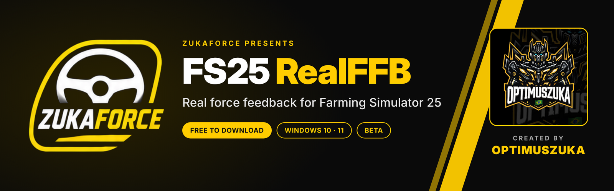
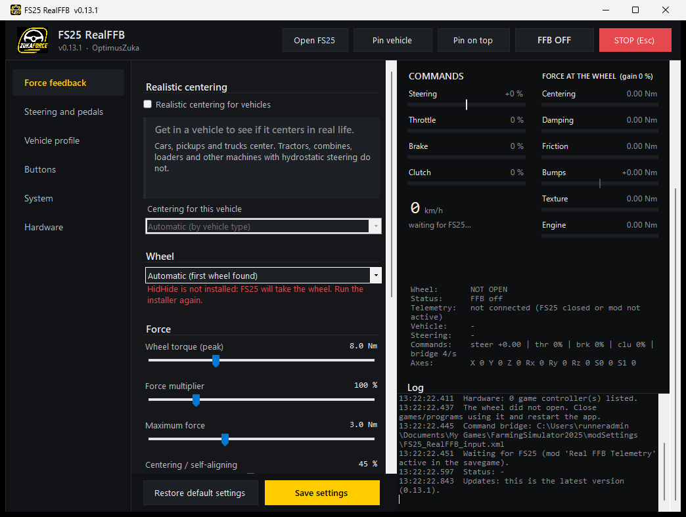
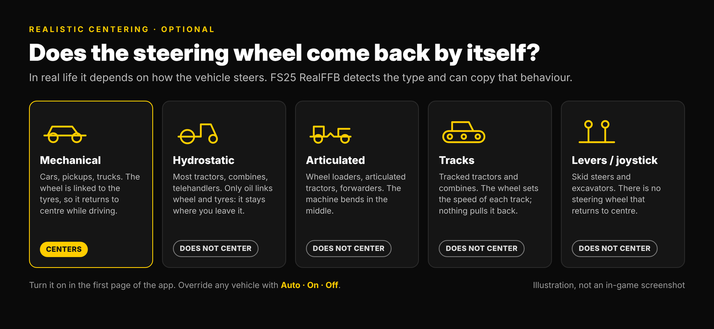
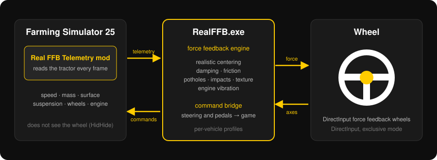

<p align="center">
  
</p>

<p align="center">
  <a href="../../releases"></a>
  <a href="../../releases"></a>
  
  
  
  <a href="LICENSE"></a>
</p>

<p align="center">
  <a href="../../releases/latest"><b>⬇ Download the latest version</b></a> ·
  <a href="docs/INSTALL.md">Installation guide</a> ·
  <a href="docs/dev/COMPATIBILITY-MATRIX.md">Supported wheels</a> ·
  <a href="docs/TROUBLESHOOTING.md">Troubleshooting</a>
</p>

---

## The problem

Farming Simulator 25 supports steering wheels, but its force feedback is almost non-existent. On a direct drive base like the Fanatec CSL DD the wheel feels loose: no weight, no return to centre, no feel of the ground. Changing the game settings does not help, because the game does not generate those forces.

## The solution

**FS25 RealFFB** creates the force feedback outside the game. A small mod reads what your vehicle is doing every frame, and a Windows app turns that into real forces at your wheel, the way racing sims and truck simulators do it.

<p align="center">
  
  <br><sub>Real screenshot of the app (v0.6 interface). Version 0.13 adds a side menu, a live vehicle view and a Hardware page.</sub>
</p>

## What you feel

| | |
|---|---|
| 🛞 **Realistic centering** | Optional. Cars and trucks return the wheel to centre; tractors with hydrostatic steering, articulated loaders, tracked machines and lever-steered machines do not, like the real ones. Override any vehicle with Auto · On · Off. |
| 🔑 **Engine start** | The wheel reacts the moment you turn the key: starter-motor pulses, a jolt when the engine catches, then idle vibration that follows RPM and load. |
| 🌾 **Terrain** | Tarmac, dirt, grass and fields each feel different. On the road you feel the hum of the agricultural tyres. |
| 🕳️ **Bumps and impacts** | Suspension bumps, potholes and collisions reach the wheel with the right strength. |
| 🤖 **AI and GPS steering** | The wheel turns by itself while an AI worker or the GPS steers. Turn it firmly against them and the vehicle is yours again. |
| 🚜 **Live vehicle view** | A top-down drawing lights up where each force comes from, with a compact "Pin vehicle" window to keep over the game. |
| 🎚️ **Per-vehicle profiles** | Every tractor or machine keeps its own tuning, switched automatically when you change vehicle. |
| 🎮 **Other controllers untouched** | Button boxes, throttle quadrants and shifters keep working directly in the game. |
| 🌍 **4 languages** | English, Portuguese (Brazil), Spanish and French, in the app and in the installer. |
| 🔄 **Updates** | The app tells you when a new version is out and installs it only with your permission, after checking the file. |

<p align="center">
  
  <br><sub>Illustration of the realistic centering rules (not an in-game screenshot).</sub>
</p>

## Safety first

- **STOP / Esc** cuts every force instantly.
- A **watchdog** stops all forces if the app freezes for more than 150 ms.
- An **oscillation guard** calms the wheel if it starts shaking around the centre.
- Forces never go above the **Maximum force** you set, and unknown wheels start with low forces.

## Supported wheels

FS25 RealFFB talks to the wheel through standard **DirectInput** force feedback, so it is built to work with most PC wheels. It only calls a wheel *confirmed* after a real test.

| Status | Wheels |
|---|---|
| ✅ **Confirmed** (tested on real hardware) | Fanatec **CSL DD 8 Nm** |
| 📄 **Documented** (standard DirectInput, not tested yet) | Fanatec GT DD Pro, Podium DD1/DD2, ClubSport, CSL Elite · Logitech G29, G920, G923, G PRO, G27, G25 · Thrustmaster T150 to T818 · MOZA R3 to R21 · Simucube 2 · Simagic · Asetek, Cammus, VRS |
| 🧪 **Experimental** | PXN · the "computed torque" output mode |
| ❌ **Not supported** | Logitech TRUEFORCE (proprietary SDK; normal force feedback still works) |

Full details, notes per model and how levels are decided: **[Compatibility matrix](docs/dev/COMPATIBILITY-MATRIX.md)**.

Own a wheel that is not confirmed yet? Open the app → **Hardware** → **Test my wheel**, drive a few minutes, then **Export compatibility report** and attach it to an [issue](../../issues). That is how a wheel becomes confirmed.

## Install

1. Open **[Releases](../../releases)** and download `FS25_RealFFB_Setup_x.y.z.exe`.
2. Run it and follow the steps. The installer finds the game, the wheel and HidHide by itself.
3. Open the **FS25 RealFFB** shortcut. It starts the app and the game.
4. In the game, enable the **Real FFB Telemetry** mod in your savegame.

Nothing to compile, no Python, no Visual Studio. The installer:
- needs administrator rights only for HidHide, which is a driver;
- backs up everything it changes;
- leaves your PC as it was when you uninstall.

> **About the Windows warning:** the installer is **not digitally signed yet**.
> - **SmartScreen** may show "Windows protected your PC". Click "More info" → "Run anyway".
> - With **Smart App Control** on, Windows blocks the installer. Download `FS25_RealFFB_BuildOnPC_x.y.z.zip` from the same release instead, extract it and double-click `install.bat`: it builds the app on your PC with the compiler included in Windows.
>
> Every release lists SHA-256 checksums so you can check the file is the original. See [INSTALL.md](docs/INSTALL.md) and [SIGNING.md](docs/SIGNING.md).

**Fanatec users:** see [docs/FANATEC.md](docs/FANATEC.md) for the recommended base settings. **Logitech users:** turn off the centering spring in Logitech G HUB.

## How it works

<p align="center">
  
</p>

1. **The mod** (`FS25_RealFFBTelemetry`) reads speed, mass, surface, suspension, engine state, steering type and steering angle. It sends them to the app through a local Windows pipe.
2. **RealFFB.exe** computes the forces in newton-metres and sends them to the wheel through DirectInput in exclusive mode: speed-dependent centering, damping and friction, bumps, surface texture and engine vibration.
3. **HidHide** ([Nefarius](https://github.com/nefarius/HidHide)) hides the wheel from the game, so only RealFFB.exe controls its force feedback. When the app closes, the wheel works normally in other games again.
4. **The command bridge** passes your steering and pedals back to the game through a small local file that the mod reads every frame.

## FAQ

**Is it free?** Yes, FS25 RealFFB is free to download and use for personal, non-commercial use.

**Does it change the game files or my savegames?** No. It is a normal FS25 mod plus a separate app. The installer adjusts one setting in `game.xml` and keeps a backup.

**Does it work in multiplayer?** The mod reads only the vehicle you are driving on your own PC.

**My wheel is not listed as confirmed. Will it work?** If it supports DirectInput force feedback it very likely will. The app reads what the wheel can do and starts with low forces. Please send a compatibility report.

**The steering of my tractor feels a little heavy and does not return to centre.** With realistic centering on, that is intended: hydrostatic steering has some viscous weight and does not self-centre. You can switch it per vehicle.

## Help and feedback

- **Something not working?** In the app, click **"Create diagnostic report"** and attach the file to an [issue](../../issues). The report does not include your user name or PC name.
- **Tested a wheel?** Send the compatibility report from the Hardware page.

## Project layout

```
src/RealFFB/         app: physics, mixer, safety, device adapters, UI, profiles, updates
src/RealFFB.Setup/   installer helper: detection, HidHide, game.xml, diagnostics
mod/                 FS25 Lua mod
installer/           Inno Setup script
tests/               automated tests with simulated wheels (no hardware needed)
docs/                guides, images and developer notes
```

`build.bat` builds everything into `dist\` and runs the tests.

## Creator

<table>
  <tr>
    <td width="170"></td>
    <td>
      <b>FS25 RealFFB</b> is created, designed and tested by <b>OptimusZuka</b> (ZukaForce) 🇧🇷, a sim driver who wanted his Fanatec CSL DD to feel like a real tractor in Farming Simulator 25.<br><br>
      Development was assisted by an AI tool (Claude, by Anthropic). Every design decision, test and tuning choice is the author's. See <a href="NOTICE.md">NOTICE.md</a>.
    </td>
  </tr>
</table>

## License

**Copyright © 2026 OptimusZuka. All rights reserved.** Free to download and use for personal, non-commercial use; see [LICENSE](LICENSE) for what is and is not allowed. Versions up to v0.6.0 were published under the MIT License and those copies keep it.

HidHide is a separate project by Nefarius Software Solutions with its own license. It is downloaded from its official repository and not redistributed here.

Farming Simulator is a trademark of GIANTS Software, Fanatec of Endor AG, Logitech of Logitech International, and other wheel brands of their respective owners. This project is not affiliated with any of them.
